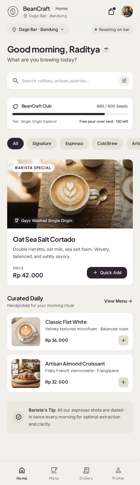
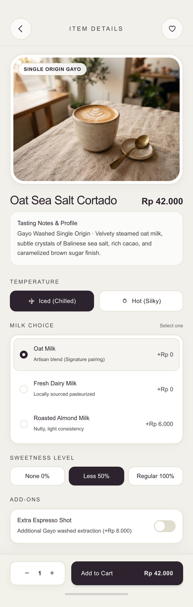
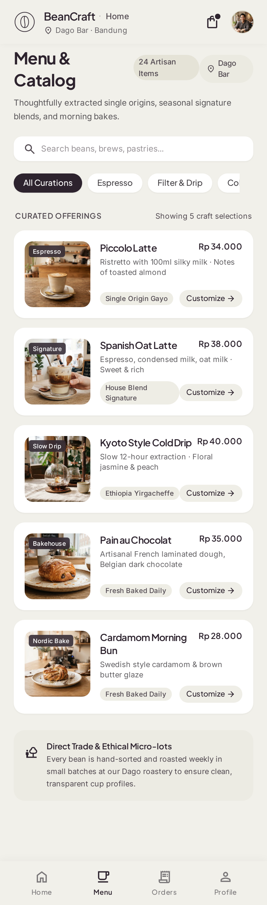
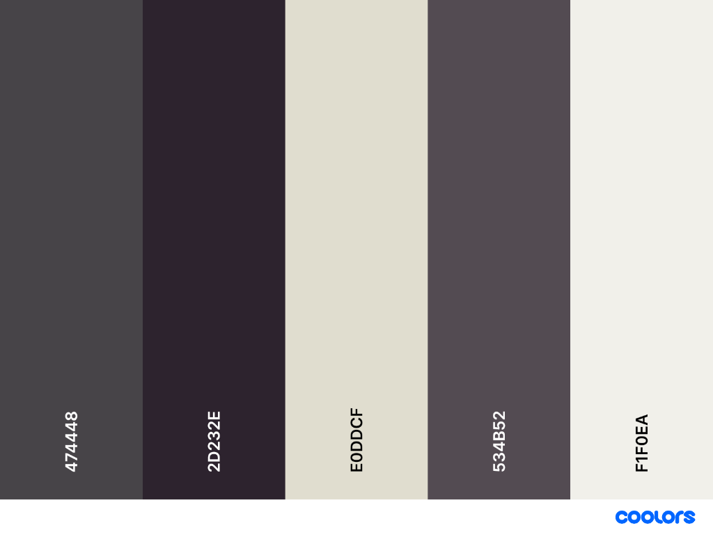

# ☕ Stoffee — Artisan Coffee & Bakery Ordering App

<div align="center">


**Tugas Ujian Tengah Semester (UTS) — Aplikasi Berbasis Platform**

Aplikasi pemesanan kopi artisan & bakery dengan alur kustomisasi minuman yang lengkap,
dibangun menggunakan **React Native (Expo)** dan **Expo Router**.

</div>

---

## 📱 Tentang Aplikasi

**Stoffee** adalah prototipe aplikasi mobile *cross-platform* untuk pemesanan kopi artisan dan
*viennoiserie* (pastry Prancis). Pengguna dapat menjelajahi katalog menu, mencari & memfilter
menu berdasarkan kategori, melakukan kustomisasi minuman (temperatur, jenis susu, tingkat
kemanisan, hingga *extra shot*), melihat keranjang belanja dengan kalkulasi tagihan otomatis,
serta memiliki kartu *loyalty stamp* digital.

**Target pengguna:** pelanggan kafe urban di Bandung yang menginginkan pemesanan cepat tanpa
antre di kasir.

---

## ✨ Fitur Utama

| Fitur | Deskripsi |
|---|---|
| 🔍 **Pencarian & Filter** | Pencarian menu *real-time* dan filter kategori (Signature, Espresso, Cold Brew, Pastry) tersedia penuh di tab **Menu** |
| 🏷️ **Promosi di Home** | Banner promo harian di halaman Home mengarahkan pengguna langsung ke katalog menu |
3. **Kustomisasi Minuman** | Pilih temperatur, jenis susu (Oat/Fresh/Almond), tingkat kemanisan, dan *extra shot* dengan perhitungan harga *live*; hasil kustomisasi langsung tersimpan ke keranjang melalui **CartContext** |
| 🛒 **Keranjang Belanja** | Menampilkan daftar item yang dipesan, pengatur jumlah (`+`/`-`), menghitung subtotal, Pajak Restoran PB1 (10%), voucher diskon, dan total pembayaran; dapat dijumlahkan ulang dan dikosongkan setelah checkout |
| 🧾 **Checkout & Invoice** | Tombol checkout yang menyimpan rangkaian tagihan dan menampilkan nomor antrean; setelah selesai keranjang otomatis dikosongkan |
| ☕ **Kartu Loyalitas Digital** | Kartu *stamp* 8 kotak dengan progress pengumpulan poin |
| 📲 **Deep Linking** | Skema URL `stoffee://` untuk navigasi eksternal |

---

## 🖼️ Tampilan Aplikasi

<div align="center">

| Home | Detail & Kustomisasi | Katalog Menu |
|:---:|:---:|:---:|
|  |  |  |
| **Keranjang & Tagihan** | **Profil & Loyalitas** | **Palet Warna** |
|  |  |  |

</div>

---

## 🧭 Alur Navigasi (Stack + Bottom Tab)

Aplikasi menggunakan **dua jenis navigasi sekaligus** sesuai spesifikasi UTS:

```
Root Stack (src/app/_layout.jsx)
│
├── (tabs)  →  Bottom Tab Navigator (src/app/(tabs)/_layout.jsx)
│   ├── index.jsx    → 🏠 Home       (dashboard & barista special)
│   ├── menu.jsx     → ☕ Menu       (katalog, pencarian, filter)
│   ├── orders.jsx   → 🛒 Pesanan    (keranjang, tagihan, checkout)
│   └── profile.jsx  → 👤 Profil     (loyalty stamp & info gerai)
│
└── details.jsx → 📄 Detail Menu (stack push, menerima params dinamis)
```

**Alur pengiriman parameter dinamis** dari Menu ke halaman Detail:

```jsx
// Mengirim data menu ke halaman detail:
router.push({ pathname: "/details", params: item });

// Menerima data di details.jsx:
const { id, title, price, origin, temp, type } = useLocalSearchParams();
```

---

## 🎨 Palet Warna

| Swatch | Hex | Peran |
|:---:|:---|:---|
| 🟤 | `#2D232E` | Primary — teks judul, tombol aksi, header |
| ⚫ | `#474448` | Secondary — deskripsi & teks pendukung |
| 🩶 | `#534B52` | Tertiary — label kategori & aksen |
| 🟡 | `#E0DDCF` | Accent — chip filter & stamp loyalitas |
| ⬜ | `#F1F0EA` | Background — latar belakang aplikasi |
| ⬜ | `#FFFFFF` | Surface — kartu & kontainer |

---

## 📁 Struktur Proyek

```
UTS-ABP-Stoffee_240040015/
├── assets/                     # Ikon, splash screen, dan screenshot
│   └── screenshots/            # Bukti visual seluruh halaman
├── src/
│   ├── app/                    # Expo Router (file-based routing)
│   │   ├── _layout.jsx         # Root Stack + CartProvider
│   │   ├── details.jsx         # Detail Menu + kustomisasi minuman
│   │   └── (tabs)/
│   │       ├── _layout.jsx     # Bottom Tab Navigator
│   │       ├── index.jsx       # Home — sapaan, banner promo, barista special, menu terpopuler
│   │       ├── menu.jsx        # Menu & Katalog
│   │       ├── orders.jsx      # Keranjang & Checkout
│   │       └── profile.jsx     # Profil & Loyalitas
│   └── context/
│       └── CartContext.jsx     # State keranjang bersama (React Context)
├── app.json                    # Konfigurasi Expo
└── package.json
```

---

## 🚀 Cara Menjalankan

```bash
# 1. Clone repositori
git clone https://github.com/radtyadharma/UTS-ABP-Stoffee_240040015.git
cd UTS-ABP-Stoffee_240040015

# 2. Instal dependensi
npm install

# 3. Jalankan development server
npx expo start
```

Lalu pindai **QR Code** yang muncul di terminal menggunakan aplikasi **Expo Go** di ponsel,
atau jalankan di emulator dengan `npx expo start --android` / `--ios`.

> Aplikasi juga telah lolos **20/20 pemeriksaan `npx expo-doctor`** tanpa error maupun warning.

---

## 📚 Sumber & Lisensi Aset

| Aset | Sumber | Lisensi |
|---|---|---|
| Ikon aplikasi | [Feather Icons via @expo/vector-icons](https://expo.github.io/vector-icons/) | MIT |
| Ikon profil pengguna | [Lucide Icons — lucide.dev](https://lucide.dev/) | ISC |
| Ikon profil pengguna | [SVG Repo — "User" vector #530585](https://www.svgrepo.com/svg/530585/user) | CC0 / SVG Repo License (attribution appreciated) |
| Palet warna | [Coolors](https://coolors.co/) | Bebas digunakan |
| Gambar & screenshot | Dokumentasi sendiri | — |
| Framework | [Expo](https://expo.dev) & [React Native](https://reactnative.dev) | MIT |

Seluruh aset yang digunakan bersifat **open-source / royalty-free** dan aman untuk keperluan
edukasi.

---

## 👤 Kontributor

| Nama | NIM | Peran |
|---|---|---|
| Putu Raditya Dharma Putra | 240040015 | Full-stack development, UI/UX design, dokumentasi |

---

<div align="center">

**Stoffee** © 2026 — Dibuat untuk UTS Aplikasi Berbasis Platform

</div>
